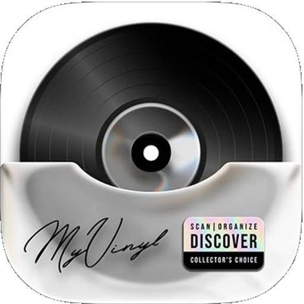

<div align="center">

  

  # Nocturne Web Player
  
  **An ultra-premium, pixel-perfect Apple Music web experience engineered with React 19, TypeScript, and Vite.**
  
  Featuring real-time synchronized karaoke lyrics, dynamic ambient glow, YouTube Music InnerTube streaming, seamless PWA installation for iOS & Android, and edge-to-edge mobile bezels.

  <p align="center">
    <a href="https://github.com/mudassir131-dev/nocturne-web/blob/main/LICENSE"></a>
    <a href="https://react.dev/"></a>
    <a href="https://www.typescriptlang.org/"></a>
    <a href="https://vite.dev/"></a>
    <a href="https://web.dev/progressive-web-apps/"></a>
    <a href="https://github.com/mudassir131-dev"></a>
  </p>

  <p align="center">
    <a href="#-key-features">Key Features</a> •
    <a href="#-progressive-web-app-pwa">PWA Installation</a> •
    <a href="#-synchronized-lyrics-engine">Synchronized Lyrics</a> •
    <a href="#-quick-start">Quick Start</a> •
    <a href="#-keyboard-shortcuts">Shortcuts</a> •
    <a href="#-license">License</a>
  </p>

  ---

</div>

## 🌟 Overview

**Nocturne Web** is a next-generation web music player inspired by the flagship Apple Music interface. Designed from the ground up to offer native-grade responsiveness, it merges Cupertino glassmorphism aesthetics with a high-performance audio engine capable of streaming full-length tracks, fetching real-time synced lyrics from multiple global providers, and operating offline as a certified Progressive Web App.

---

## 🎧 Key Features

### 🎨 1. Apple Music Visual Design System
- **Authentic Cupertino Typography**: Powered by Apple's `SF Pro Display`, `SF Pro Text`, and `-apple-system` font stacks.
- **Dynamic Light & Dark Modes**: Automatically harmonizes with your OS color scheme, or adapts intelligently with zero flicker.
- **Cupertino Glassmorphism**: Multi-layered backdrop blurs (`backdrop-filter: blur(28px)`), subtle translucent borders, and Apple-grade vibrant shadows.
- **Edge-to-Edge Bezel Display**: Cards, carousels, and editorial banners stretch flush to your mobile display bezels without unsightly grey scrollbars.
- **Zero Tap Delay**: Custom touch-action optimizations eliminating blue tap selection boxes on mobile devices.

### ⚡ 2. High-Fidelity Audio Engine
- **Decoupled Architecture**: Standardized `PlayerAdapter` contract backed by `BrowserAudioAdapter` with full `HTML5 AudioElement` and `MediaSession` API integration.
- **Gapless Queuing & History**: Shuffle, loop-one, loop-all, and drag-and-drop playlist reordering inside the queue drawer.
- **Lossless Audio Indicator**: Dynamic badge rendering Apple Lossless audio status with accurate bitrate and bit-depth metadata.
- **Hardware Integration**: System lock-screen media controls, Bluetooth audio synchronization, and keyboard media keys support.

### 🎤 3. Real-Time Synchronized Lyrics (`LyricsView`)
- **Multi-Provider Fallback Aggregator**: Centralized lyrics engine pulling from **LRCLIB**, **Kugou**, **YouLy+**, **Paxsenix**, **BetterLyrics**, **SimpMusic**, and YouTube Timed Captions.
- **Karaoke Active-Line Glow**: The current line illuminates in bold white text with a soft atmospheric neon aura, while inactive lines remain elegantly muted.
- **Click-to-Seek**: Tap any lyric line to instantly jump track playback to that millisecond.
- **Auto-Follow Center Scrolling**: Smooth auto-centering viewport tracking the vocalist in real time.

### 📱 4. Progressive Web App (PWA)
- **Standalone App Experience**: Installs directly onto your home screen on **iOS**, **Android**, **macOS**, and **Windows**.
- **1-Click Native Install**: Built-in install prompt listening for `beforeinstallprompt` on Chromium and Android.
- **iOS Safari Guide Modal**: Authentic Apple sheet walking iPhone/iPad users through tapping the Share icon and choosing *"Add to Home Screen"*.
- **Adaptive System Bars**: Status bar (`theme-color`) and Android navigation bar dynamically match the dominant palette of the playing song or active route.

### 🧭 5. Smooth Routing & History Stack
- **Hardware & Browser Back Button**: Full synchronization with `window.history.pushState` and `popstate` events.
- **Top Chevron Controls**: Sleek Apple-style back/forward navigation buttons with dynamic enabled/disabled states.
- **Full Library & Curated Shelves**: Dedicated pages for **Home**, **New**, **Radio**, **Search**, **Albums**, **Playlists**, **Artists**, and **Library**.

---

## 📱 Progressive Web App (PWA)

Nocturne can be installed as a native app on any platform:

| Platform | Installation Method |
| :--- | :--- |
| **Android / Chrome / Edge** | Click the **"Install"** button in the top navigation bar or browser URL bar for instant 1-tap installation. |
| **iOS / iPadOS (Safari)** | Tap the **Share** button in Safari, scroll down, and select **"Add to Home Screen"** 📱. |
| **Windows / macOS** | Click the install icon in the browser address bar to install Nocturne as a standalone desktop application. |

---

## ⌨️ Keyboard Shortcuts

Control playback effortlessly without touching your mouse:

| Shortcut | Action |
| :---: | :--- |
| <kbd>Space</kbd> | Toggle Play / Pause |
| <kbd>→</kbd> / <kbd>←</kbd> | Seek forward / backward by 5 seconds |
| <kbd>]</kbd> / <kbd>[</kbd> | Skip to Next track / Previous track |
| <kbd>↑</kbd> / <kbd>↓</kbd> | Increase / Decrease volume (5% steps) |
| <kbd>M</kbd> | Mute / Unmute audio |
| <kbd>L</kbd> | Open / Close Synchronized Lyrics view |
| <kbd>Esc</kbd> | Dismiss Expanded Player or Queue Drawer |

---

## 🛠️ Tech Stack & Architecture

```
nocturne-web/
├── public/                  # PWA Manifest, service worker, icons & SVG sprites
├── server/                  # Vite API plugin, YouTube InnerTube service & Lyrics providers
│   ├── apiPlugin.ts         # Backend audio proxy & streaming route (/api/music/stream)
│   ├── innertube-service.ts # High-level YouTube Music client wrapper
│   └── lyrics/              # Multi-engine lyrics aggregator (LRCLIB, Kugou, YouLy+)
├── src/
│   ├── components/
│   │   ├── artwork/         # CarouselCardShelf, EditorialShelf, ContentCard
│   │   ├── common/          # AppleFooter, PwaInstallPrompt, AdaptiveWallpaper
│   │   ├── expanded-player/ # DedicatedPlayer modal & full-screen artwork stage
│   │   ├── lyrics/          # LyricsView karaoke synchronizer
│   │   ├── mini-player/     # Persistent bottom floating player bar
│   │   ├── navigation/      # Desktop Sidebar, MobileNav bottom tab bar
│   │   ├── queue/           # Up Next queue drawer
│   │   └── track-list/      # TrackRow with animated equalizer bars
│   ├── context/             # PlayerContext (audio state) & ThemeContext (adaptive colors)
│   ├── data/                # Curated Apple Music catalog & charts
│   ├── pages/               # Home, New, Search, Radio, Album, Artist, Playlist, Library
│   ├── services/            # BrowserAudioAdapter, lyricsService, playlistStorage
│   └── styles/              # Apple Design tokens, typography & CSS animations
```

- **Frontend Core**: React 19, TypeScript, Vite
- **Icons**: Lucide Icons & Custom Apple SF Pro SVG Sprites
- **Audio & Media**: HTML5 Media API, MediaSession API, AudioContext
- **PWA**: Service Worker (`sw.js`), Web App Manifest, Standalone Display Mode
- **Styling**: Vanilla CSS3 Custom Properties (zero CSS runtime bloat, maximum performance)

---

## 🚀 Quick Start

### Prerequisites
- [Node.js](https://nodejs.org/) (version 18 or higher recommended)
- `npm` or `pnpm`

### Installation

1. **Clone the repository**:
   ```bash
   git clone https://github.com/mudassir131-dev/nocturne-web.git
   cd nocturne-web
   ```

2. **Install project dependencies**:
   ```bash
   npm install
   ```

3. **Start the local development server**:
   ```bash
   npm run dev
   ```

4. **Access the application**:
   - **Local Desktop**: Open [http://localhost:5173/](http://localhost:5173/)
   - **Mobile Testing**: Open `http://<your-local-ip>:5173/` on any phone connected to the same Wi-Fi network.

5. **Build for production**:
   ```bash
   npm run build
   ```

---

## 👨‍💻 Developer & Attribution

- **Developer**: Mudassir Khan ([@mudassir131-dev](https://github.com/mudassir131-dev))
- **Repository**: [https://github.com/mudassir131-dev/nocturne-web.git](https://github.com/mudassir131-dev/nocturne-web.git)
- **Project**: Nocturne Web Player

---

## 📄 License

This project is licensed under the terms of the **GNU General Public License v3.0 (GPL-3.0)**.  
See the [LICENSE](LICENSE) file for complete terms and conditions.

---

<div align="center">
  <p>Crafted with ❤️ for music enthusiasts worldwide.</p>
  <p>© 2026 <b>Nocturne</b>. All rights reserved.</p>
</div>
